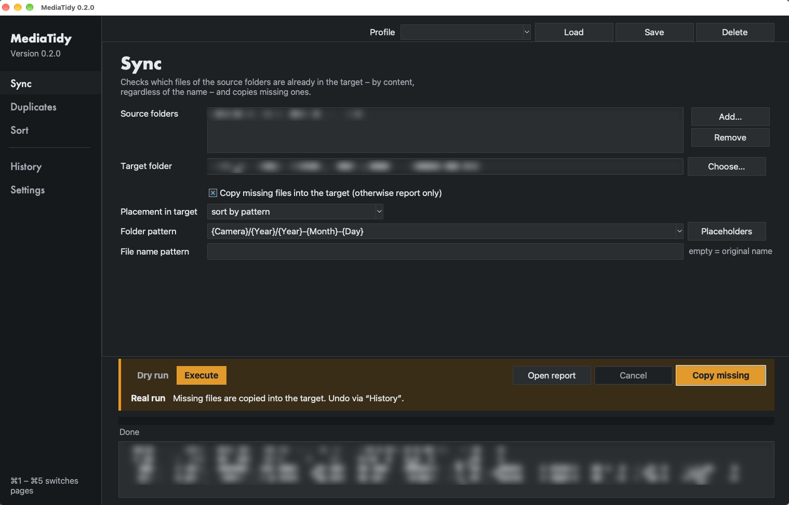
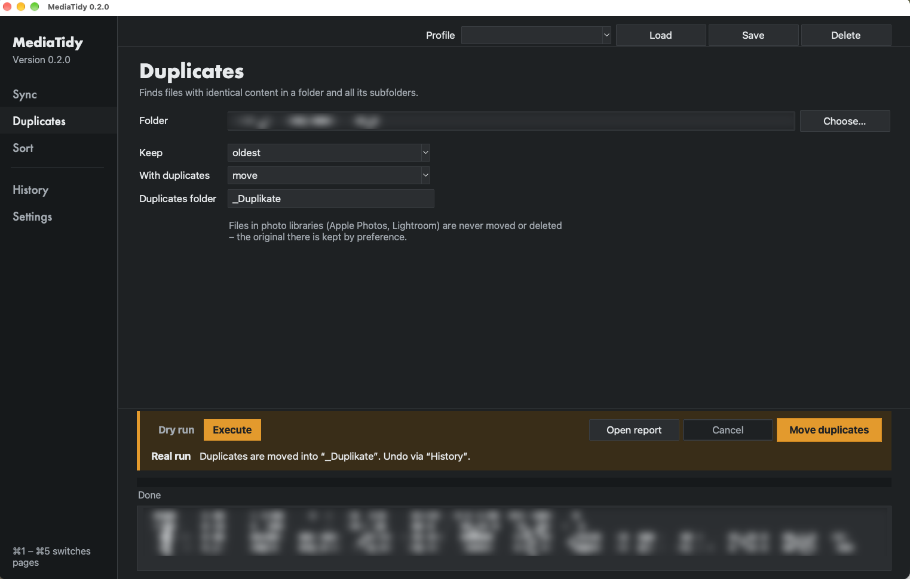
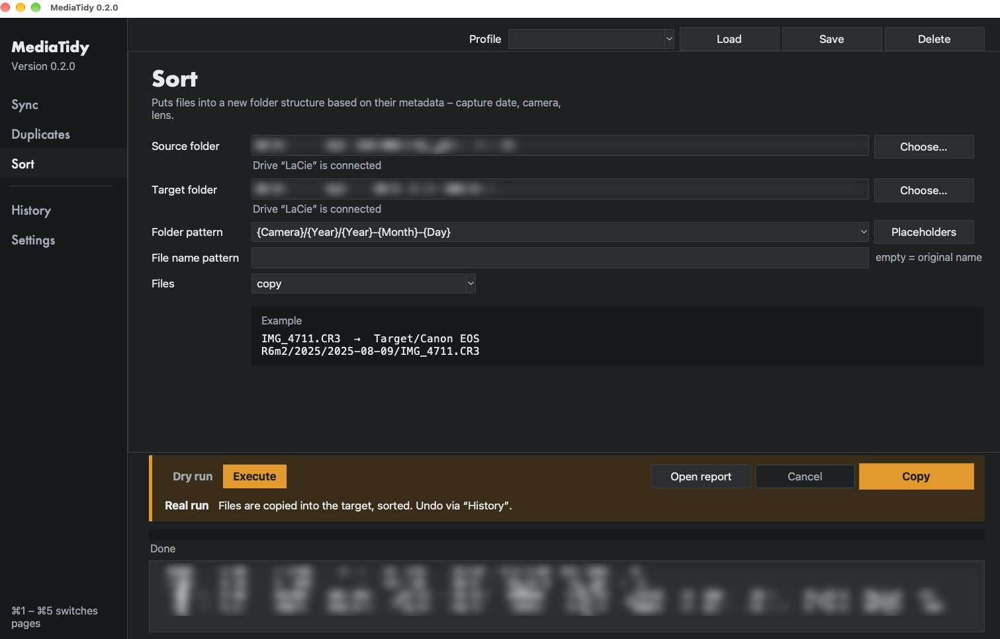

# MediaTidy

[](https://github.com/Ben-ReverseLab/media-tidy-mac/actions/workflows/tests.yml)
[](https://github.com/Ben-ReverseLab/media-tidy-mac/releases/latest)
[](https://scorecard.dev/viewer/?uri=github.com/Ben-ReverseLab/media-tidy-mac)
[](LICENSE)

A macOS app for photographers: compare photos and videos between folders and drives, find duplicates, and sort files into folders by their metadata (capture date, camera, lens …).



- **Content-based** – files are compared by checksum, not by name.
- **Safe by default** – every run is a dry run unless you explicitly execute it; every real action is logged and can be undone.
- **Library-aware** – reads the originals inside Apple Photos (`.photoslibrary`) and Lightroom (`.lrlibrary`) libraries without ever modifying them, and warns before moving files that a Lightroom Classic catalog uses.
- **Sidecar-aware** – XMP/AAE sidecars travel with their photos and are kept up to date in backups.
- **English and German** – the app, its reports and the command line follow the macOS language; it can also be set in Settings (`ui.language`).
- **Configurable** – every option lives in one documented settings file and on the Settings page.

> **Warning:** MediaTidy copies, moves and (if you choose) trashes files. Keep a backup of your photos, start with a dry run and read the report before executing. The software is provided without warranty (see [LICENSE](LICENSE)).

## Installation

1. Download **[MediaTidy.dmg](https://github.com/Ben-ReverseLab/media-tidy-mac/releases/latest)** (macOS 13 Ventura or later, Apple silicon and Intel), open it and drag **MediaTidy** into **Applications**. Everything it needs, including [ExifTool](https://exiftool.org), is built in.
2. **First start:** MediaTidy is free and open source but not notarized by Apple (that needs a paid Apple developer account), so macOS blocks it the first time:
   - **macOS 15 or later:** open MediaTidy, click **Done**, then open **System Settings → Privacy & Security**, scroll down and click **Open Anyway** (shown for about an hour), confirm with your password.
   - **macOS 13–14:** right-click (Control-click) MediaTidy → **Open** → **Open**.
   - Or in Terminal: `xattr -dr com.apple.quarantine /Applications/MediaTidy.app`
3. **Permissions** – macOS grants file access per app:
   - **External drives:** macOS asks on first access → click “Allow”.
   - **Apple Photos library:** System Settings → Privacy & Security → **Full Disk Access** → `+` → select MediaTidy.

   Updates keep these permissions: every release is signed with the same certificate ([details](packaging/signing-certificate.txt)).

### Homebrew

```sh
brew install --cask ben-reverselab/tap/mediatidy
```

The first start works as described above. `brew upgrade` installs new versions.

### Verify a download (optional)

```sh
shasum -a 256 -c MediaTidy-<version>.dmg.sha256
gh attestation verify MediaTidy-<version>.dmg --repo Ben-ReverseLab/media-tidy-mac   # built by GitHub Actions from this repository
```

## Usage

Open **MediaTidy** from Applications.

### Pages

| Page | Purpose |
|---|---|
| Sync | Compare several source folders with one target by content. Copy what is missing – keeping the folder structure or sorted by a pattern. Duplicates within the sources are copied only once. Sidecars (XMP/AAE) of already backed-up files are added, or replaced when the source is newer (the old version is kept for undo). |
| Duplicates | Find files with identical content in a folder tree. Choose which copy to keep and what to do with the others: report only / move to a duplicates folder / move to Trash. A shared XMP (`IMG.xmp` next to `IMG.CR3` and `IMG.JPG`) always belongs to the RAW file. |
| Sort | Copy or move files into a folder structure by capture date, camera, lens, type …, optionally renaming them. |
| Settings | All options, generated from `defaults.toml` with explanations. |
| History | Every real run is logged and can be undone. |

<p>
  
  
</p>

- **Dry run** is on by default: shows what would happen, as an HTML/CSV report.
- **Empty files** (0 bytes) are reported as “probably damaged” and neither compared nor copied.
- **Profiles**: save a page’s inputs under a name (e.g. “Pictures → Backup drive”) and load them later.
- **Interrupted runs**: just start again – already copied files are recognised. Copies are written under a temporary name, verified by checksum and only then renamed.

## Patterns

`/` separates folders. Placeholders:

| Placeholder | Meaning | Placeholder | Meaning |
|---|---|---|---|
| `{Year}` | year (2025) | `{Hour}` | hour |
| `{Month}` | month, two digits (08) | `{Minute}` | minute |
| `{MonthName}` | month name | `{Second}` | second |
| `{Day}` | day, two digits | `{Camera}` | camera model |
| `{Quarter}` | quarter (Q3) | `{Make}` | camera make |
| `{Week}` | ISO week (W32) | `{Lens}` | lens |
| `{WeekYear}` | year of the ISO week | `{Type}` | RAW / Photo / Video |
| `{Weekday}` | weekday | `{Ext}` | file extension |
| `{Name}` | original file name | `{Folder}` | current folder name |
| `{Source}` | source folder name | | |

Examples: `{Year}/{Year}-{Month}-{Day}`, `{Camera}/{Year}`, file name `{Year}{Month}{Day}_{Hour}{Minute}{Second}_{Name}`.

In the German interface placeholders are shown with German names (`{Jahr}`, `{Kamera}` …); both spellings are accepted everywhere. Month names, weekdays, `{Type}` and “Unknown” follow the app language and can be overridden in Settings (`patterns.month_names`, `metadata.unknown`).

**Name review:** if a pattern uses `{Camera}`, `{Make}` or `{Lens}`, MediaTidy lists all names it has not seen before – after reading the metadata, before changing anything. Example: a drone that writes slightly different model names into its photos and videos. Rename or accept them; the mapping is saved in Settings → Metadata (`camera_names`, `make_names`, `lens_names`) and not asked again. Turn off with `metadata.review_names = false`.

## Command line

The app has a command line too:

```sh
alias mediatidy=/Applications/MediaTidy.app/Contents/MacOS/MediaTidy   # e.g. in ~/.zshrc
mediatidy sync --source ~/Pictures/2025 --target /Volumes/Backup/Photos
```

From a source checkout (see [Development](#development)) use `python3 -m mediatidy` instead:

```sh
python3 -m mediatidy sync --source ~/Pictures/2025 --source ~/Pictures/2026 --target /Volumes/Backup/Photos
python3 -m mediatidy sync --profile "Pictures → Backup" --execute
python3 -m mediatidy duplicates --folder /Volumes/Backup/Photos --action move --execute
python3 -m mediatidy sort --source ~/Import --target ~/Sorted --pattern "{Year}/{Camera}" --move --execute
python3 -m mediatidy undo --execute
```

Without `--execute` every command is a dry run. `--yes` confirms trashing/overwriting. `python3 -m mediatidy --help` and `python3 -m mediatidy <command> --help` list all options.

| Command | Purpose |
|---|---|
| `sync` | compare sources with a target, copy missing files (`--report-only`, `--placement structure\|pattern`, `--pattern`, `--filename`) |
| `duplicates` | find duplicates (`--keep oldest\|newest\|shortest_path\|longest_path\|first`, `--action report\|move\|trash`) |
| `sort` | sort by metadata (`--pattern`, `--filename`, `--move`) |
| `undo` | undo the last run (`--file` for a specific journal) |
| `profiles` | list saved profiles |
| `check` | check dependencies and drive access (exit code 1 if there are problems) |

## Files

| Path | Contents |
|---|---|
| `~/.mediatidy/config.toml` | Your settings (only values that differ from the defaults) |
| `~/.mediatidy/profiles/` | Saved profiles |
| `~/.mediatidy/journal/` | Log of every action (for undo) |
| `~/.mediatidy/reports/` | All reports (real runs also put a copy into `_MediaTidy-Reports` in the target) |
| `~/.mediatidy/cache.db` | Checksum cache (makes repeated runs fast; safe to delete) |
| `~/.mediatidy/logs/` | Log files |

## Development

### Run from source

Needs Python ≥ 3.11 with tkinter and ExifTool; no other Python packages.

```sh
brew install python-tk@3.14 exiftool          # Homebrew; any Python ≥ 3.11 with tkinter works
git clone https://github.com/Ben-ReverseLab/media-tidy-mac.git
cd media-tidy-mac
app/build-app.sh                              # builds MediaTidy.app (a small launcher, signed locally)
python3 -m mediatidy check                    # checks dependencies and drive access
```

If Homebrew asks for it, run `sudo xcodebuild -license accept` first. Double-click the **`MediaTidy.app`** in the cloned folder and grant the permissions to it (not to Terminal); after rebuilding it you may have to grant Full Disk Access again. It has its own app identifier (`…mediatidy.source`), so its permissions are separate from the downloadable app. `MediaTidy.command` also works, but then Terminal needs the permissions. Python code changes take effect after restarting the app; rebuilding is only needed after changes to `app/MediaTidy.applescript`.

Settings defaults with explanations: `mediatidy/defaults.toml`; texts per language: `mediatidy/locales/`.

### Notes

- Python standard library + tkinter only; external tools: exiftool (and Finder via `osascript`).
- Code, comments and data formats are English; user-facing texts live in `mediatidy/locales/*.toml` (same keys in every language, checked by a test).
- New setting: add it with a comment to `defaults.toml` → it appears automatically on the Settings page (English help = the comment; German label/help: `setting.<key>` / `help.<key>` in `de.toml`).
- Incompatible config change: increase `CONFIG_VERSION` in `config.py` and add a function to `MIGRATIONS`.
- Unit tests (about a second): `python3 -m unittest discover -s tests` – GitHub Actions runs them on every push to `main` and on pull requests (`.github/workflows/tests.yml`).
- Downloadable app: `packaging/build.sh` (PyInstaller, used only for building – see the comments in the script). Pushing a tag `v<version>` (= `mediatidy.__version__`, with a CHANGELOG section) builds, signs and publishes the release and updates the Homebrew cask (`.github/workflows/release.yml`); running that workflow manually only builds the DMG as an artifact. Bundled third-party software: [THIRD_PARTY_NOTICES.md](THIRD_PARTY_NOTICES.md). The app icon is drawn by `swift packaging/icon/make-artwork.swift`.
- Real-world check with generated photos/videos and disk images: `python3 tests/real_world_check.py` (3–5 min, needs exiftool and ffmpeg). **It moves test files into your real Finder Trash** and mounts temporary disk images.

## License

[MIT](LICENSE)

Not affiliated with or endorsed by Apple or Adobe. Apple, macOS, Finder and Apple Photos are trademarks of Apple Inc.; Lightroom is a trademark of Adobe.
